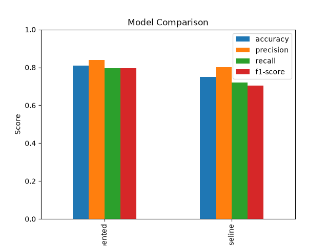

# Weather Image Classification

## 概要
CNN(畳み込みニューラルネットワーク)を用いて
画像を晴れ(sunny)・曇り(cloudy)・雨(rainy)の3クラスに分類するAIを開発した．

## 使用技術
- Python：プログラミング言語
- TensorFlow / Keras：CNNモデルの構築・学習
- NumPy：画像データや配列の処理
- Pillow：画像の読み込み・リサイズ
- scikit-learn：データ分割・モデル評価
- Matplotlib：学習結果・評価結果の可視化
- Pandas：評価結果の集計・比較

## モデル構成
本プロジェクトではCNNを使用した．

Conv2D → MaxPooling2D → Conv2D → MaxPooling2D → GlobalAveragePooling2D → Dense → Dense

また学習時のデータ拡張として
RandomBrightnessとRandomContrastを導入した．

## データセット
本プロジェクトではMendeley Dataで公開されている
”Multi-class Weather Dataset for Image Classification”を使用した．
### 出典
- データセット名：Multi-class Weather Dataset for Image Classification
- 著者：Gbeminiyi Ajayi
- 公開年：2018年
- 公開元：Mendeley Data
- ライセンス：CC BY 4.0
- DOI：10.17632/4drtyfjtfy.1
- URL：https://data.mendeley.com/datasets/4drtyfjtfy/1

元のデータセットの4クラス(cloudy，rain，shine，sunrise)のうち，sunriseを除く3クラスを用いた．またクラス名をsunny，cloudy，rainyに統一した．
### 使用画像
| クラス | 画像枚数 |
|---|---:|
| sunny(晴れ) | 253枚 |
| cloudy(曇り) | 300枚 |
| rainy(雨) | 215枚 |
| **合計** | **768枚** |

## 前処理
- RGB形式に変換
- 画像サイズを224×224ピクセルに統一
- 画素値を0～1に正規化
- 学習用70%，検証用15%，テスト用15%を目安に分割

データ分割にはscikit-learnのtrain_test_splitを使用し，
stratifyによってクラス比率を維持した．
### ライセンス・クレジット
Dataset: Ajayi, Gbeminiyi (2018), Multi-class Weather Dataset for Image Classification, 
Mendeley Data, V1. DOI: 10.17632/4drtyfjtfy.1.

License: Creative Commons Attribution 4.0 International (CC BY 4.0).

本プロジェクトでは元データセットから使用クラスを選択し，
クラス名の変更及び学習時の前処理を行った．

上記のMendeley Dataからデータセットを取得し，
以下のフォルダ構成で画像を配置してください．

```text
data/
├──sunny/
├──cloudy/
└──rainy/
```

元のデータセットの`shine`は`sunny`，`rain`は`rainy`として配置する．`sunrise`は使用しない．

## モデル評価
テストデータを用いてベースラインモデルとデータ拡張モデルの性能を比較した．

| モデル | Accuracy | Precision | Recall | F1-score |
|---|---:|---:|---:|---:|
| baseline | 0.7500 | 0.8025 | 0.7205 | 0.7033 |
| augmented | 0.8103 | 0.8388 | 0.7953 | 0.7953 |

### 比較結果
今回の実験ではデータ拡張モデルのAccuracyが0.8103となり，
ベースラインモデルの0.7500を上回った．

またPrecision，Recall，F1-scoreについても
データ拡張モデルの方が高い値を示した．

ただし，今回の結果は各モデルの個別の学習結果に基づくため，
データ拡張による改善効果を厳密に評価するには，
乱数条件を統一した複数回の実験が必要である．

### モデル比較グラフ


## 実行方法
プロジェクトのルートディレクトリで以下のコマンドを実行する．

### 1.必要なライブラリのインストール
```bash
pip install -r requirements.txt
```

### 2.モデルの学習
```bash
python train.py
```

### 3.モデルの評価
```bash
python evaluate.py
```

### 4.モデルの比較グラフ作成
```bash
python -m src.compare
```

### 5.画像の天気予測
```bash
python -m src.predict sample.png
```

複数画像を指定して連続で予測することも可能．


**注意：** 学習済みモデル（`.keras`ファイル）はGitHubに含まれていません．
画像の天気予測を実行する前に，`python train.py` でモデルを学習・保存してください．


```bash
python -m src.predict sample.png data/sunny/shine1.jpg
```

## 今後の課題
今回のモデルでは雨や曇りの画像を誤分類する場合があるため，
分類制度の改善が課題である．

特に雨の画像については空の様子だけではなく，
窓ガラスの水滴や傘，雨でぬれた道路など，
雨天時の特徴が写った画像を追加することで
より多様な特徴を学習させたいと考えている．

また追加する画像の内容や枚数によって
分類制度がどのように変化するかを検証し，
モデル改善につなげたい．
